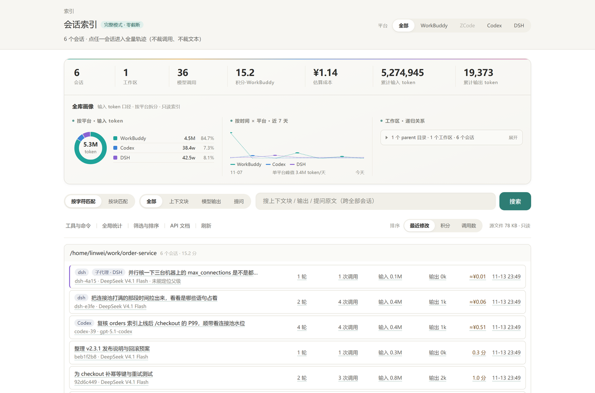
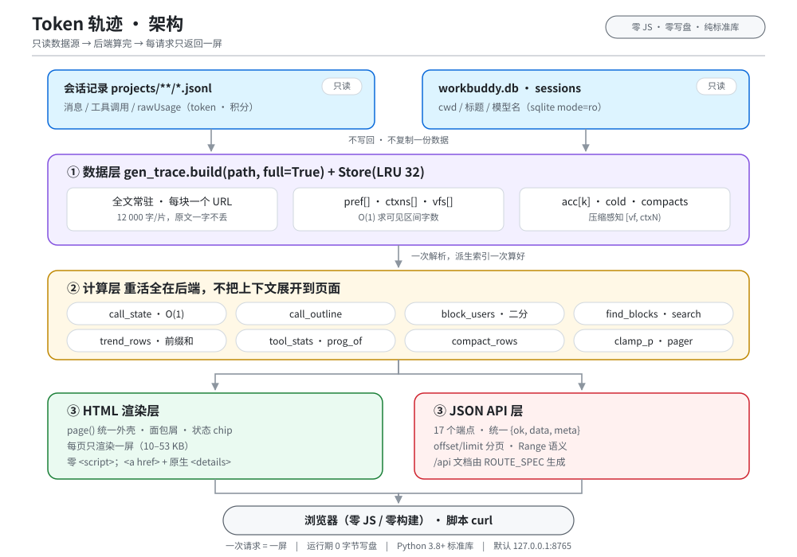
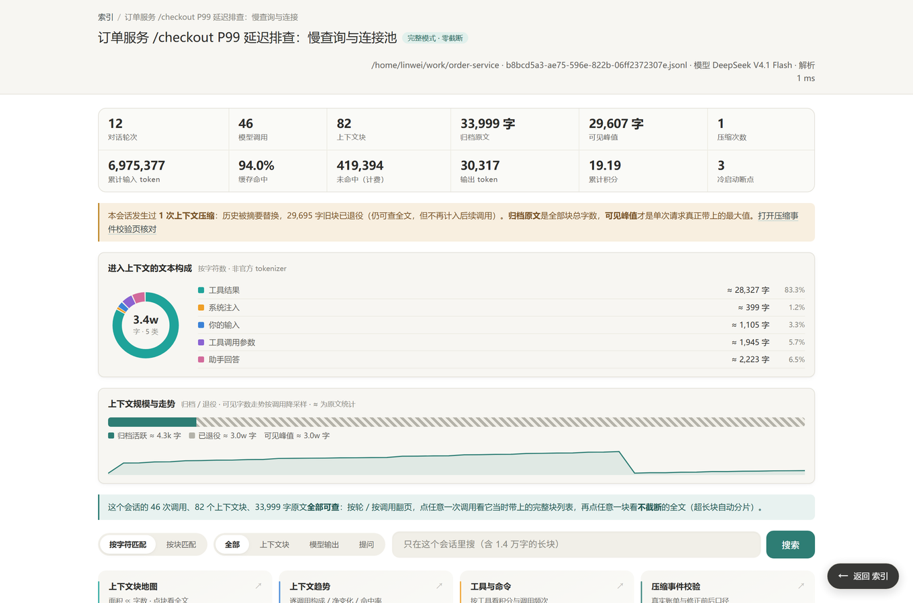

# Token 轨迹

把 WorkBuddy 的会话记录还原成逐次调用的 token 轨迹：每一次调用花了多少积分、带上了哪些上下文、缓存命中到哪里，都能逐条回溯到原文；页面零 JavaScript、运行期零写盘，只依赖 Python 3.8+ 标准库。**在银河麒麟 V10 SP1（兆芯）实测通过**，适配银河麒麟 / 统信 UOS / Deepin 等国产 Linux，提供 `deb` 包与桌面图标、无需 apt 安装第三方依赖，Windows 另有单文件启动器。



*会话索引：全库画像（按模型的输入 token 环、按天走势、工作区递归关系）与会话列表。截图中的数据由 `scripts/make_demo.py` 虚构生成，模型 ID 为平台公开标识，不含任何真实用户数据。*

   

## 目录

- [1 概览](#1-概览)
  - [亮点](#亮点)
  - [两种模式](#两种模式)
  - [架构一览](#架构一览)
  - [功能总览](#功能总览)
- [2 安装与发行](#2-安装与发行)
  - [一键安装（推荐）](#一键安装推荐)
  - [前置条件](#前置条件)
  - [Linux：一键启动](#linux一键启动)
  - [Windows：一键启动](#windows一键启动)
  - [命令行](#命令行)
  - [发行产物](#发行产物)
  - [版本记录](#版本记录)
- [3 使用指南](#3-使用指南)
  - [页面导航](#页面导航)
  - [JSON API](#json-api)
  - [配置](#配置)
- [4 功能详解](#4-功能详解)
  - [块检索：怎么定位到具体块](#块检索怎么定位到具体块)
  - [工具与命令聚合](#工具与命令聚合)
  - [上下文趋势](#上下文趋势)
  - [压缩感知：只算本次真正带上的块](#压缩感知只算本次真正带上的块)
- [5 实现与维护](#5-实现与维护)
  - [实现要点](#实现要点)
  - [仓库内容](#仓库内容)
  - [维护：路由声明与自检](#维护路由声明与自检)
- [6 实测与口径](#6-实测与口径)
  - [实测数据](#实测数据)
  - [数据来源与口径](#数据来源与口径)
  - [这个工具能回答什么](#这个工具能回答什么)
- [7 已知限制](#7-已知限制)
- [License](#license)
---

## 1 概览

### 亮点

- **看得全** —— 1328 次调用、2575 个上下文块全部可单独打开；最大的一块 579 969 字
  分 49 片取回，拼接后与 API 全文逐字一致。旧静态页只保留最近 150 次调用。
- **页面轻** —— 单页 10–53 KB、113–517 个 HTML 标签、0 个 `<script>`。
  正文不进列表页，58 万字的大块在列表里只是一行引用。
- **装得上** —— 两个 Python 文件、纯标准库；Linux 双击桌面图标、Windows 双击
  `start.cmd`，都自动起服务并打开浏览器，重复点不会多起进程。
- **不添乱** —— 源数据只读，运行期 0 字节写盘（连 `__pycache__` 都关掉）；
  两轮 600 请求后 RSS 稳定在 88.7 MB，第二轮完全不涨。


### 两种模式

| 维度 | 完整模式（推荐） | 静态模式（离线兜底） |
| --- | --- | --- |
| 入口 | `trace_server.py` + 浏览器 | `gen_trace.py` → `trace/index.html` |
| 内容 | 零截断，全部调用与原文 | 最近 150 次调用、每块 3000 字 |
| 前端负担 | 每屏 10–53 KB | 单页 1–4.6 MB |
| 搜索 / 筛选 / JSON API | 有 | 无 |
| 额外要求 | 本地起一个服务 | 无，`file://` 双击即开 |
| 适用 | 日常排查、看全文、脚本取数 | 拷给别人、归档、无 Python 环境查看 |

完整模式解决的是一对矛盾：**内容要全，页面又不能重**。做法是把「展开」变成一次后端请求 ——
翻页、点某次调用、看某个块的全文，都由服务端查数据、算缓存边界、渲染好一屏再返回。
浏览器永远只拿一屏，但任何一条数据都能顺着链接走到，一个字符都不丢。

零 JavaScript 是踩出来的硬约束：托管预览（`/static-html/<hash>/`）不执行 `<script>`，
所以核心路径全部是 `<a href>` + 原生 `<details>`，禁用脚本照样能用。

选型建议：本机排查一律用完整模式；只有要把结果发给别人、或目标机器不能跑 Python 时，
才用静态模式生成一份 HTML。两者共用同一套解析原语，不会算出两套数字。


### 架构一览



> 图源是 `docs/architecture.mmd`（Mermaid），README 引用 `docs/architecture.svg`，
> 不依赖阅读器是否支持 Mermaid；浅色 / 深色主题都可读。

| 层 | 职责 | 刻意不做 |
| --- | --- | --- |
| 数据源 | `projects/**/*.jsonl` + `workbuddy.db`，全程只读 | 不写回、不复制一份数据 |
| 数据层 | `build(path, full=True)` 重建块序列，`Store` LRU 常驻 + 前缀和派生索引 | 不建倒排索引、不落盘 |
| 计算层 | `call_state` / `call_outline` / `block_users` / `search` / `trend_rows` 等，O(1) 或二分 | 不把整段上下文展开到页面 |
| 渲染 / API 层 | 每请求只产出一屏 HTML 或一条 `{ok,data,meta}` JSON | 不一次性注入大 JSON、不截断全文 |

### 功能总览

- 按工作区分组的会话索引，可按时间 / 积分 / 调用数排序
- 逐轮、逐调用回溯：usage、积分、缓存命中边界、带上了哪些上下文块
- 每个块单独看全文，超长块自动分片；可反查「哪些调用带过它」
- 思考过程与最终回答按段分片查看（这部分不占输入上下文）
- 全库全文搜索，命中片段带跳转链接；按命中 / 未命中 / 跨边界筛选
- **块检索**：按块聚合列出全部命中，给出块内命中总数与所在分片，点片号直跳并高亮
- **工具与命令聚合**：按工具看调用次数 / 积分 / 命中率，按 shell 程序看执行频次，可下钻到该工具的每一次调用
- **上下文趋势**：逐调用渐变色带柱看五类内容的累计组成与净变化（25% 网格、左侧刻度、命中率折线、压缩 / 冷启动旗标），按调用 / 按轮切换，点柱直达调用详情
- **上下文块地图**：面积 ∝ 字数的 SVG treemap，按类型着色、同色深浅二次编码；`?k=` 按类型聚焦，点任意块直跳不截断全文
- **轻量视觉系统**：低饱和墨青主色 + 近墨灰文字链接（全局 `a` 兜底，不再落回浏览器默认亮蓝）、CSS 设计令牌 + 深浅色自适应、构成环、归档 / 退役斜纹条、可见字数走势、会话活动日历热力图；KPI 统一为连续数字带且**列宽按内容分配**（两位数的「会话」不再和九位 token 一样宽），首页数字条与三张图合成一块概览面板；图表样式按页面按需注入
- **过渡与返回**：跨文档淡入（淡出 240ms / 淡入 460ms）、KPI 数字区局部 morph（540ms）、卡片 / 数字入场渐变（500 / 600ms，50ms 错峰）、`<details>` 展开高度渐变（400ms），全站共用 `--ease` 缓动曲线；悬浮「返回上一层」胶囊 + 页脚同名链接，父级从面包屑自动推导，长内容页不用浏览器回退
- **首页工具条**：导航、排序、元信息合成一条分区横带，取代原先两行 pill 按钮；排序为分段控件，窄屏自动折行
- **命中块折叠**：调用详情里连续命中块默认折成一枚紧凑胶囊「#a–#b 块缓存命中」，展开时才铺成全宽标题条并拉出逐块清单；「按调用浏览」每行也带同样的折叠摘要；主动选「只看命中」时全部展开
- **轮来源标签**：`role=user` 的消息并不都是你输入的。每轮标为「用户消息 / 后台任务 / 压缩摘要 / 系统注入 / 内部消息」，非真人输入显示可读摘要而不是整段 XML；会话页可按类别筛选，单轮详情也按来源改标题
- **子代理隶属树**：子代理是独立的 `agent-*` 会话文件，且工作区常与主会话不同。首页把同一页内的父子收编成「父会话行 → 缩进子树」（原生 `<details>` 折叠、零脚本），子行带 `└` 连接符并注明「派生自「父会话标题」」，分组标题标「含 N 个子代理」；父子跨页或无法定位父级时改在行内注明，关系不会凭空消失。匹配优先用子会话的 `rootRequestId` 精确对照派发它的 `Agent` 调用，字段缺失时才退回 5 秒时间窗兜底
- **首页全库画像**：按模型的输入 token 环（按 `providerData.model` 分组、忽略展示名大小写差异，不依赖 db）、按时间的输入 token 折线、工作区路径递归树（两级 + 占比条），只消费已缓存的会话索引；「按时间」折线与「会话活动日历」都按**每次调用实际发生的日期**分桶（`scan_all()` 预聚合的 `days`），不把整个会话压到文件最后修改日，跨天会话也能落到各自那天
- **同机互链**：服务端用一次 loopback `/api/ping`（150 ms 超时、结果缓存 15 s）判断同机的 WorkBuddy 用量监视是否在跑，在跑才在工具条与页脚放「实时用量 ↗」，没跑就不渲染——页面上不会出现死链；地址可用 `TRACE_MONITOR_URL` 改
- **统一检索入口**：单行搜索区，左侧用零脚本分段开关切换「按字符匹配 / 按块匹配」并由服务端分流，输入框吃掉剩余宽度、按钮贴右；会话页入口改为无边框渐变卡片（分类色侧条）+ 分段浏览控件，次要链接降级
- 缓存命中率统一显示到小数点后一位
- **压缩感知**：识别上下文压缩，只统计本次请求真正带上的块；压缩事件页把真实账单与修正前后口径并列，可人工核对
- 跨会话统计：字数构成、最贵调用、最大块、冷启动断点、计费单价
- 17 个 JSON 端点，统一 `{ok, data, meta}` 信封，供脚本调用
- Linux / Windows 各有一键启动与停止脚本，幂等、自动开浏览器


## 2 安装与发行

### 一键安装（推荐）

从 [Releases 最新页](https://github.com/The-garden-of-sinner/token-trace/releases/latest)
下载附件即可，**不用 clone 仓库、不用 pip install、不用构建**。

**Linux（Debian / Ubuntu / 银河麒麟 / 统信 UOS / Deepin）**

```bash
V=1.1.8   # 换成 Release 页上的最新版本号
curl -fLO "https://github.com/The-garden-of-sinner/token-trace/releases/download/v$V/token-trace_${V}_all.deb"
sudo dpkg -i "token-trace_${V}_all.deb"
token-trace                     # 起服务并自动打开浏览器
```

装好后也可以从应用菜单点「Token 轨迹」。只依赖系统自带的 `python3 (>= 3.8)`，
`dpkg` 不会联网拉第三方包；`token-trace stop` 停止、`token-trace status` 查状态、
`TRACE_PORT=9000 token-trace` 换端口。

**Windows**

下载 `TokenTrace.bat` 双击即可；单文件自包含，不需要同目录放任何 `.py`，
也不需要管理员权限。或者一行命令下载并启动：

```powershell
Invoke-WebRequest "https://github.com/The-garden-of-sinner/token-trace/releases/latest/download/TokenTrace.bat" -OutFile TokenTrace.bat
.\TokenTrace.bat
.\TokenTrace.bat shortcut       # 首次：创建带图标的桌面 / 开始菜单快捷方式
```

Release 还附 `SHA256SUMS`。`.bat` 是纯文本，Windows 不支持对它做 Authenticode 签名，
所以完整性靠哈希清单核对：

```bash
sha256sum -c SHA256SUMS
```
```powershell
Get-FileHash .\TokenTrace.bat -Algorithm SHA256   # 与 SHA256SUMS 里的值比对
```

下面几节讲从源码运行与产物细节，只想用工具的话到这里就够了。

### 前置条件

| 组件 | 说明 |
| --- | --- |
| Python 3.8+ | 仅标准库；实测 3.8 与 3.13 均可 |
| WorkBuddy 会话数据 | `~/.workbuddy/projects/**/*.jsonl` 与 `~/.workbuddy/workbuddy.db`，由客户端产生，本工具只读 |
| 浏览器 | 任意；纯 HTML 页面，零脚本、无构建步骤 |
| Windows：PowerShell 5.1+ | 系统自带，仅启动器用到；核心 Python 文件不依赖它 |

全部依赖仅 Python 标准库与只读的会话文件；安装到用户目录即可，
服务运行期保持对 WorkBuddy 数据零写入。

### Linux：一键启动

```bash
./start.sh                     # 后台起服务 → 等就绪 → 开浏览器
./start.sh stop                # 停止
TRACE_PORT=9000 ./start.sh     # 换端口
TRACE_NO_BROWSER=1 ./start.sh  # 只起服务、不开浏览器（无头 / 自动化）
```

双击桌面图标效果相同。克隆到新机器时先跑一次 `./install-desktop.sh`：它把
`token-trace.desktop` 模板里的 `@EXEC@` 替换成当前目录的 `start.sh` 绝对路径，
再装到桌面与 `~/.local/share/applications/`，不写死任何用户名或目录。

`start.sh` 用系统 `python3 -B`（`-B` 保持零写盘），实测冷启动 2.0 s、未预热常驻 23.5 MB；
停止走 `POST /shutdown` 让服务自己退出，不依赖 `pkill` 找 PID。

### Windows：一键启动

```powershell
.\windows\start.cmd                    # 双击或命令行，一键启动
.\windows\start.ps1 stop               # 停止
.\windows\start.ps1 restart            # 重启
.\windows\start.ps1 status             # 查看状态
.\windows\start.ps1 -Port 9000         # 换端口
.\windows\install-shortcut.ps1         # 首次：创建桌面 / 开始菜单快捷方式
```

数据目录默认 `%USERPROFILE%\.workbuddy`；客户端装在别处时用 `-WorkBuddyHome`
或环境变量 `WORKBUDDY_HOME` 覆盖。

### 命令行

```bash
python3 trace_server.py                       # http://127.0.0.1:8765/
python3 trace_server.py --port 9000 --warm    # 换端口并预解析全部会话
python3 trace_server.py --cache 4             # 内存吃紧时只缓存 4 个会话（会让 /stats 变慢）

python3 gen_trace.py                          # 静态模式：全部会话 → trace/
python3 gen_trace.py path/to/x.jsonl -o out.html
python3 gen_trace.py --all                    # 静态模式保留全部调用（正文仍截 3000 字）
```

`Ctrl+C` 停止服务。`--all` 只取消「最多 150 次调用」的裁剪，正文截断由静态模式自身的
`MAX_TEXT` 控制，所以它不等于完整模式。

### 发行产物

Release 里附两个开箱即用的包和一份校验清单，**都不需要 clone 仓库**：
下载入口见「一键安装（推荐）」。

| 产物 | 平台 | 用法 |
| --- | --- | --- |
| `token-trace_<版本>_all.deb` | Debian / Ubuntu / 麒麟等 | `sudo dpkg -i ...`，应用菜单或终端 `token-trace` |
| `TokenTrace.bat` | Windows | 双击，单文件自包含；`shortcut` 建带图标的快捷方式 |
| `SHA256SUMS` | 全平台 | `sha256sum -c SHA256SUMS` 核对附件完整性 |

#### Linux：deb 包

```bash
sudo dpkg -i token-trace_<版本>_all.deb
token-trace                  # 起服务 + 开浏览器
token-trace stop             # 停止
token-trace status           # 查看状态
TRACE_PORT=9000 token-trace  # 换端口
```

装到 `/usr/share/token-trace/`（两个 `.py` + README + LICENSE）、`/usr/bin/token-trace`
和 `/usr/share/applications/token-trace.desktop`。依赖只有 `python3 (>= 3.8)` ——
探活与关停都走 Python 标准库，不依赖 `curl`；没有 `xdg-open` 时只打印 URL，不会失败。
只读 `~/.workbuddy`，不写系统数据目录。

#### Windows：单文件 bat

`TokenTrace.bat` 是**自包含**的：`trace_server.py`、`gen_trace.py` 与
`assets/TokenTrace.ico` 经 zlib + base64 压缩后内嵌在文件尾部。双击时脚本自动寻找
Python 3.8+（`py -3` → PATH → 常见安装目录 → WorkBuddy 内置运行时），把一段纯 ASCII
loader 释放到 `%LOCALAPPDATA%\TokenTrace\launcher.py`，由它在内存里注册 `gen_trace`
并启动服务，等就绪后打开浏览器。

- **不需要** clone 仓库、同目录放 `.py`、`pip install` 或管理员权限；
- 正常启动只写 `launcher.py`（纯 ASCII），两个真实源码始终在内存里，避开中文 Windows
  控制台的编码问题；图标只在 `shortcut` 子命令时释放为同目录 `TokenTrace.ico`。
  bat 本身纯 ASCII + CRLF、无 BOM，不写死任何路径；
- 重复双击只开浏览器，不会多起进程；启动横幅带版本号；
- 子命令：`stop` / `status` / `shortcut`（建带图标的桌面与开始菜单快捷方式）/
  `version` / `help`；`TRACE_PORT=9000` 换端口，
  `TRACE_PYTHON=C:\path\to\python.exe` 指定解释器；
- 图标源是 `scripts/make_icon.py`（Pillow 生成 16–256 七档 ico），
  Linux 侧同一份设计装进 hicolor 主题；`windows/install-shortcut.ps1` 也优先用它；
- **bat 不能内嵌图标或做 Authenticode 签名**：批处理是纯文本，不是 PE 文件
  （Windows 的图标与签名都针对 PE）。图标通过快捷方式实现，完整性由 Release 的
  `SHA256SUMS` 保证；`windows/sign-release.ps1` 是给维护者用自有证书签 `.ps1`
  的可选入口，仓库不附带任何证书。详见「已知限制」；
- **尚未在真实 Windows 机器上验证**，见「已知限制」。

#### 从源码重建

```bash
python3 scripts/make_icon.py         # -> assets/TokenTrace.ico / token-trace.png
python3 scripts/build_win_bat.py     # -> dist/TokenTrace.bat（自动内嵌图标）
./scripts/build_deb.sh               # -> dist/token-trace_<VERSION>_all.deb（需 dpkg-deb）
python3 scripts/build_deb.py         # 无 dpkg-deb 时（如 Windows）的等价构建，纯标准库
python3 scripts/make_checksums.py    # -> dist/SHA256SUMS
./scripts/release.sh                 # tag 已推到远端后，建 Release 并上传三者
```

版本号统一放在 `scripts/VERSION`；`dist/` 与 `.build/` 不入库。
`build_deb.py` 直接读取 `build_deb.sh` 的 heredoc 作为唯一内容来源，再用标准库写出
ar + `control.tar.gz` + `data.tar.gz` 容器，因此与 `dpkg-deb` 产物同构、不会两处维护漂移；
它只用于「本机没有 `dpkg-deb`」的场景，Linux 发版仍以 `build_deb.sh` 为准。
tar 成员与 gzip 容器头的 `mtime` 都固定为 0（`GzipFile(..., mtime=0)`），同输入两次
构建字节一致，可用 `sha256sum` 复核。校验：`dpkg-deb -c dist/token-trace_<VERSION>_all.deb`。


### 版本记录

| 版本 | 主要内容 |
| --- | --- |
| **v1.1.8** | 修复首页「按模型 · 输入 token」环把同一模型按 `requestModelName` 大小写变体拆成多份（改为按 `providerData.model` 分组、全库投票统一展示名；`sum(models)==sum(pin)` 不变），环心数字按字数收字号不再压环；首页子代理改为「父会话行 → 缩进子树」展示隶属关系（原生 `<details>` 折叠、零脚本，子行标「派生自」，跨页 / 未能定位父级时在行内注明），不再作为孤立工作区分组平铺。README 口径同步。自检 102 项 |
| **v1.1.7** | 同机互链：探测到 WorkBuddy 用量监视（`workbuddy-token-monitor --web`，默认 `127.0.0.1:8791`）在运行时，工具条与页脚出现「实时用量 ↗」；`/api/health` 自报 `monitor=up/down/disabled`；地址可用 `TRACE_MONITOR_URL` 覆盖，置空即关闭探测。自检 89 项 |
| v1.1.6 | 第二轮复测修复：① 首页 500 —— `subagent_relations()` 对字符串时间戳直接做减法，`first_ts` 统一用 `_ms()` 归一，0 值不再参与就近匹配；② 分页后分组标题用本页切片计数、与分页条口径冲突，改为按该工作区全量统计并在被切开时标「本页 N」；③ `rootRequestId` 采而未用，改为父子关系首选的精确键（`agent_reqs`），时间窗降级为兜底，嵌套子代理可挂到直接父级；④ `build_deb.py` 的 gzip 容器头写墙钟时间，改用 `GzipFile(mtime=0)`，构建真正可复现。README 补「渲染性能」实测（兆芯集显帧率与测量方法）；另修 `src_bytes` 单文件失效即整页失真、页脚 KB 迭代轮数；自检补 12 项（子代理边界 / 脏时间戳渲染 / 分组计数 / 残差桶 / `/stats` 解析次数 / `?kind=` 非法值与转义 / `build_deb` 版本号校验）增至 85 项 |
| v1.1.5 | 视觉收尾：KPI 数字带列宽改为**按内容分配**（`kpi_weights()` 估算每格文字宽度并输出 `fr` 表，两位数的「会话」不再和九位 token 等宽，12 项两行仍按列对齐）；工具条 / 检索区 / 分段控件 / 入口卡 / 会话分组 / 图表卡补齐入场错峰；构成环各段按起始角度错峰生长、概览与走势折线用 `clip-path` 从左往右揭开、渐变色带柱 `scaleY` 拉起；README 替换为最新界面截图（会话索引 + 会话概览）。自检 73 项 |
| v1.1.4 | 社区复测反馈修复：`--cache` 默认改为按会话数自适应（cap < 会话数会让 `/stats` 每轮全部重解析，33 会话 / cap 32 实测约 5 s）；首页会话列表分页（此前 132 个会话时 94.8 KB 会顶破 80 KB 硬闸）；`page(need=...)` 显式声明样式，空库不再丢 `.hero` / `.toolbar`；页脚体积改算整页响应；源文件体积 / 长块字数改为运行时计算；修面包屑双重转义、模型环残差与 DST 分桶。自检增至 73 项 |
| v1.1.3 | 轮来源标签（你发的 / 后台任务 / 压缩摘要 / 系统注入 / 内部消息）与 `?kind=` 筛选，非真人输入改显可读摘要；首页「会话 · 子代理关系」面板与会话列表子代理标签；新增 `scripts/build_deb.py`（无 `dpkg-deb` 时用纯标准库构建等价 deb）；Release 补齐 bat / deb / SHA256SUMS 附件。自检 64 项 |
| v1.1.2 | 前端可视化升级：设计令牌 + 深浅色、SVG 构成环 / 日历热力图 / 块地图、渐变色带趋势柱、按需 CSS 注入；跨文档过渡动效与「返回上一层」；连续命中块折叠、命中率一位小数、首页全库画像、检索与菜单重构；模型名改从 jsonl 的 `providerData` 按输入 token 聚合（不再依赖 `workbuddy.db`），链接配色与首页 / 菜单 / 折叠视觉统一，工具条重排与过渡节奏放缓；修复单轮详情无分页撑破 80 KB 硬闸。自检 64 项 |
| v1.1.1 | 修复 Windows 调用详情页 500（毫秒时间戳未归一，统一 `fmt_ts()` 并加越界保护，自检增至 63 项）；新增引用 Release 的一键安装、项目图标与 `TokenTrace.bat shortcut` 带图标快捷方式、`SHA256SUMS` 完整性校验与可选签名入口 |
| v1.1.0 | 工具与命令聚合、逐调用上下文趋势与 Delta、声明式路由表 `ROUTE_SPEC` + 58 项固化自检、**压缩感知统计修复**（可见区间 `[vf, ctxN)`、压缩事件校验页、独立复核脚本）；文档补齐三部分单价与峰谷倍率口径 |
| v1.0.1 | 块检索：按块聚合命中、给出命中分片并直跳高亮 |
| v1.0.0 | 完整模式（零 JS 服务端按需渲染）、17 个 JSON 端点、双平台一键启动、deb 与自包含单文件 Windows bat |

版本号统一写在 `scripts/VERSION`，发版流程见「从源码重建」。


## 3 使用指南

### 页面导航

打开首页后按「工作区 → 会话 → 轮 / 调用 → 上下文块 → 块全文」逐层进入。
每一级都是独立 URL，可收藏、分享、用 `curl` 直接取。



*会话概览：12 项统计、上下文文本构成环、可见规模与归档 / 退役对比条、按轮 / 按调用 / 工具 / 趋势的入口卡。同一份虚构数据。*

| 路由 | 内容 |
| --- | --- |
| `/` | 会话索引；`?sort=mtime\|credit\|calls`、`?ws=`、`?refresh=1` |
| `/stats` | 跨会话聚合、最贵 20 次调用、最大 20 个块、冷启动断点 |
| `/search?q=&scope=&mode=` | 全文搜索；`scope=blocks\|outputs\|turns\|all`；`mode=blocks` 由服务端转交按块检索；会话内为 `/s/<sid>/search` |
| `/find?q=&p=` | **按块精确检索**（跨会话）；`/s/<sid>/find?q=` 为会话内；也可从搜索框切「按块匹配」进入 |
| `/tools?tool=&view=&q=&p=` | **工具与命令聚合**；`view=tools\|progs` 切换，`tool=` 下钻到该工具全部调用；会话内为 `/s/<sid>/tools` |
| `/s/<sid>/trend?g=&mode=&p=` | **上下文趋势**；`g=call\|turn` 粒度，`mode=total\|delta` 累计组成 / 净变化 |
| `/s/<sid>/map?k=&n=` | **上下文块地图**；`k=` 按块类型聚焦（`user` / `injected` / `tool_result` / `tool_call` / `assistant`），`n=4..48` 控制铺砖数，默认 24 |
| `/s/<sid>/compact` | **压缩事件校验**：真实账单与修正前 / 后统计逐条并列 |
| `/s/<sid>?view=turns\|calls&p=&kind=` | 会话概览，按轮或按调用分页；按轮时 `kind=all\|user\|task\|compact\|injected\|other` 按来源筛选 |
| `/s/<sid>/t/<n>?p=` | 单轮的全部调用，每页 40 条（一轮几百次调用也不会撑破单页上限） |
| `/s/<sid>/c/<seq>?state=&p=` | 单次调用的上下文块清单；`state=all\|hit\|miss\|part` |
| `/s/<sid>/b/<idx>?part=&q=&ref=` | 块全文分片；`raw=1` 纯文本，`q=` 高亮命中并列出命中片 |
| `/s/<sid>/o/<seq>?seg=&part=` | 该次调用的输出（思考 / 回答）分片 |
| `/api` | API 文档页 |

`<sid>` 必须匹配 `[0-9A-Za-z_-]+` 且存在于会话索引，防目录穿越；所有输出统一 `html.escape`。

### JSON API

统一信封 `{"ok":true,"data":...,"meta":{...}}`；出错是 `{"ok":false,"error":"..."}` 加 4xx/5xx。
分页统一 `offset` / `limit`，`meta` 给 `total` / `offset` / `limit`，有下一页时给 `next` 完整 URL。

| 端点 | 说明 |
| --- | --- |
| `GET /api/health` | 状态、`pid`、`rss_mb`、`uptime_s`、会话数、缓存数、`write_files=false` |
| `GET /api/sessions` | 全部会话摘要 |
| `GET /api/stats` | 跨会话全量聚合 |
| `GET /api/s/<sid>` | 会话统计 + 每轮摘要 + 冷启动调用号 |
| `GET /api/s/<sid>/calls?offset=&limit=&turn=` | 调用列表（不含正文） |
| `GET /api/s/<sid>/calls/<seq>` | 单次调用：usage、缓存边界、块总数、输出段索引 |
| `GET /api/s/<sid>/calls/<seq>/context?offset=&limit=&state=` | 块清单（不含正文，可按状态筛选） |
| `GET /api/s/<sid>/blocks/<idx>?offset=&limit=&full=1` | 块全文，Range 语义（`limit` 按字符）；`full=1` 一次取完 |
| `GET /api/s/<sid>/blocks/<idx>/users` | 哪些调用带上了这个块 |
| `GET /api/s/<sid>/outputs/<seq>?seg=&offset=&limit=` | 输出全文，分段 + 分片 |
| `GET /api/s/<sid>/turns/<n>` | 某一轮的全部调用 |
| `GET /api/search?q=&sid=&scope=&limit=` | 全文搜索，返回命中位置、片段与跳转链接（块结果带 `part`） |
| `GET /api/find?q=&sid=&offset=&limit=` | 按块聚合检索：命中块、块内命中数、命中分片与直跳链接 |
| `GET /api/s/<sid>/blocks/<idx>/find?q=&offset=&limit=` | 单块内全部命中位置与所在分片（分页） |
| `GET /api/tools?sid=&view=&tool=&offset=&limit=` | 工具 usage 聚合 / Shell 程序频次；带 `tool` 时下钻到该工具的全部调用 |
| `GET /api/s/<sid>/trend?g=&offset=&limit=` | 逐调用上下文演化：按类型组成、字数、命中率、积分与相邻 delta；每行带 `compact` |
| `GET /api/s/<sid>/compact` | 压缩事件：真实 `pin`/`hit`/`credit` 与修正前后可见字数对照、`consistent` 计数 |
| `POST /shutdown` | 停止服务，供 `start.sh stop` 调用；校验 Host / Origin / Sec-Fetch-Site |

```bash
curl -s "http://127.0.0.1:8765/api/sessions" | python3 -m json.tool
curl -s "http://127.0.0.1:8765/api/s/<sid>/calls?limit=5"
curl -s "http://127.0.0.1:8765/api/s/<sid>/blocks/42?offset=0&limit=1000"
curl -s "http://127.0.0.1:8765/api/search?q=缓存冷启动"
curl -s "http://127.0.0.1:8765/api/find?q=缓存冷启动&limit=5"
curl -s "http://127.0.0.1:8765/api/s/<sid>/blocks/42/find?q=缓存"
curl -s "http://127.0.0.1:8765/api/s/<sid>/compact"
```

`/health`（纯文本 `ok`）、`HEAD`、404 / 500 都按 HTTP 语义处理；响应带
`Cache-Control: no-store`，源文件改了刷新即可看到新数据，不会拿到陈旧页。

### 配置

| 参数 | 环境变量 | 默认 | 说明 |
| --- | --- | --- | --- |
| `--port` | `TRACE_PORT` | `8765` | 监听端口，启动器同样支持 |
| `--host` | — | `127.0.0.1` | 绑定非本机地址时**必须**同时给 `--token`，否则拒绝启动 |
| `--token` | `TRACE_TOKEN` | 空 | 访问令牌；非空时所有请求都要带 `?token=` 或 `Authorization: Bearer` |
| `--cache` | — | `0`（自适应） | LRU 保留几个已解析会话；0 = `max(32, 会话数 + 8)`，上限 256 |
| `--warm` | — | 关 | 启动时预解析全部会话（约 3–7 s，换更快的首次搜索） |
| 不开浏览器 | `TRACE_NO_BROWSER=1` | — | 无头 / 自动化场景 |
| 数据目录 | `WORKBUDDY_HOME` | `~/.workbuddy` | Windows 启动器也支持 `-WorkBuddyHome` |
| 用量监视地址 | `TRACE_MONITOR_URL` | `http://127.0.0.1:8791/` | 同机监视器的地址；置空则关闭互链探测（不再尝试连接） |

Windows 的 `start.ps1` 对应参数是 `-Port` / `-NoBrowser` / `-Token`（别名 `-ShutdownToken`）/
`-WorkBuddyHome`，动作支持 `start | stop | restart | status`。

单页渲染上限在 `trace_server.py` 顶部：

| 常量 | 值 | 含义 |
| --- | --- | --- |
| `PAGE_TURNS` / `PAGE_CALLS` / `PAGE_BLOCKS` | 20 / 40 / 40 | 各列表每页条数 |
| `PART_CHARS` | 12 000 | 全文每片字数 |
| `SEARCH_MAX` / `API_MAX_LIMIT` | 80 / 500 | 搜索与 API 单次返回上限 |
| `FIND_MAX_BLOCKS` | 40 | 块检索结果每页块数 |
| `FIND_MAX_HITS` / `FIND_MAX_PARTS` | 500 / 60 | 单块最多记录多少处命中 / 导航最多列多少片 |
| `FIND_CACHE_MAX` / `FIND_CACHE_TTL` | 8 / 60 s | 检索结果缓存条数与有效期 |
| `HL_MAX` | 200 | 单片最多高亮多少处（守住单页体积） |


## 4 功能详解

### 块检索：怎么定位到具体块

全文搜索回答「哪些地方出现了这个词」，块检索回答「**哪些块含有它、块内有多少处、分别落在哪一片**」。

旧实现里 `search()` 用 `rx.search()` 只取每块第一处命中，跳转链接是 `/b/<idx>`，
一律落在第 1 片。58 万字的大块切成 49 片，命中在第 27 片就得手翻 26 次，
进去之后也没有任何高亮。现在分两层，**都不建倒排索引**：

| 层 | 做什么 | 代价 |
| --- | --- | --- |
| `search()` | `rx.search` 找首处，链接直接带 `part=<pos//PART_CHARS>&q=` | 命中即停，最快 |
| `find_blocks()` | `rx.finditer` 扫完每块，按块聚合成一行，记 `count` / `positions` / `parts` | 全量扫描，热缓存约 0.4–0.6 s |

`parts` 是命中位置整除 `PART_CHARS` 后的去重分片号 —— 不需要额外索引，
`O(命中数)` 就能把「块内第 266 137 字」翻译成「第 22 片」。打开
`/b/2387?part=22&q=Stdout`，后端只渲染这一片（12 000 字），用
**先切原文、再逐段 esc** 的方式包 `<mark>`：先 esc 整段再跑正则会把 `&amp;`
从中间切开，拼出坏 HTML。

零 JS 保持不变：命中片号是一排 `<a class="btn">`，「下一处命中」也是普通链接。
体积靠三道闸守住：结果 40 块/页、列表页每块最多 8 个片链接（超出给「全部 N 片 →」）、
单片最多高亮 200 处。实测 6 000 字全命中时 HTML 仅 8.6 KB。

结果按 `(关键词, 会话)` 缓存在进程内，8 个词 / 60 秒 TTL（与会话索引同步失效）；
翻页、回看、点进块页都不重扫 940 万字。源文件新增会话后点「强制重检」或加 `refresh=1`。


### 工具与命令聚合

`tool_stats()` 从 `calls` 里按工具名累加次数、积分、输入/输出 token 与命中率；
程序名只从 `tool_result` 块中 **Bash / Shell 类**工具的命令摘要 `c` 里提取 ——
这份摘要是 `brief(args)` 的结果，URL、搜索词、生图描述都不参与。
`prog_of()` 会跳过 `cd` / `export` / 控制流前缀段和后面还有实质命令的装饰性 `echo`，
取第一个实际程序（本机 1345 条命令以 `cd <dir> &&` 开头，不跳就会全部归成一类）。
点工具名进入下钻页，按积分降序列出该工具的每一次调用，每行直达调用详情。

**实测**（29 会话 / 5933 次调用）：20 种工具，Bash 2799 次 / 527.47 分占大头，
其后是最终回答 1338 次、Edit 812 次、Read 431 次；2797 条 shell 命令归出 173 种程序，
Top 为 `python3` 552、`ls` 251、`grep` 216。聚合结果缓存 60 秒，
首次 3.6 s（含冷解析）、之后 0.01 s；页面 8–22 KB、零 `<script>`。
程序名是 best-effort 归类，纯控制流命令会归入「(shell 控制流)」，不是精确的执行追踪。


### 上下文趋势

`trend_rows()` 用「按类型字数前缀和」把每次调用的上下文构成压到 **O(1)**：
预计算 `acc[k][i] = 前 i 块里类型 k 的字数`，第 seq 次调用的可见区间是 `[vf, ctxN)`，
取 `acc[k][ctxN] − acc[k][vf]` 就是五类组成，`pref[ctxN] − pref[vf]` 是可见总字数。
否则每次调用都遍历整个可见区间会退化成 O(C²)。

`/s/<sid>/trend` 两个维度：`g=call|turn` 按 1328 次调用或按 103 轮
（每轮取最后一次调用）；`mode=total` 按五类颜色堆叠累计组成，
`mode=delta` 墨青为增长、红色为回落，高度按 |Δ| 归一化。
柱子是 `<a href>` 包住的纯 CSS 堆叠 `<i>`，悬停用原生 `title`，
点进去直达该次调用的完整块清单 —— 零 JavaScript、每页 40 根、页面 27–36 KB。
红点标记命中率骤降的冷启动调用，琥珀点（◆）标记上下文压缩 —— 那一柱会断崖下降。
表格同步给出 Δ 字 / Δ 积分的精确数值。

**实测（最大会话）**：1328 行计算耗时 **0.025 s**；
「五类构成之和 == 可见字数」与「Δ == 相邻行之差」逐行核对，各 **0** 处不符。
可见峰值 946 336 字（归档原文 2 556 958 字），两次压缩分别造成
**−561 648 字**与 **−364 327 字**的断崖 —— 这才是上下文演化的真实形状。
（修正前的旧口径会一路涨到 240 万字并掩盖这两次下降，见下节。）
分页越界会与 `pager()` 同步夹到最后一页，不会出空表。


### 压缩感知：只算本次真正带上的块

WorkBuddy 的自动压缩会**把历史整体替换**成一条 `<cb_summary>` 用户消息。
jsonl 是 append-only，旧消息仍然留在文件里，但压缩后模型只看得到摘要 + 之后的对话。
早期版本把 jsonl 逐行都算作后续调用的可见上下文，于是出现方向性错误：
真实 `prompt_tokens` 降了 71%，工具统计的「可见字数」反而涨了 36%，
而且那个「579 969 字的最大块」其实就是压缩摘要，不是工具结果。

**修法**：`build()` 读 `providerData.isCompacted` 标记，给每次调用记一个
`vf`（visible_from，可见区间起点）。所有计算把区间从 `[0, ctxN)` 换成 `[vf, ctxN)`：

| 位置 | 修正后 |
| --- | --- |
| `call_outline` / `call_state` | 只列 `[vf, ctxN)` 的块；区间外返回 `None`，不计 hit/miss |
| 缓存边界 | 按可见区间内的相对字数定位，再换回绝对块号 |
| `block_users` | 下界 `bisect_right(ctxns, idx)`、上界 `bisect_right(vfs, idx)`，压缩后不再算「带过」 |
| `trend_rows` | `pref[ctxN] − pref[vf]`、按类型 `acc[k][ctxN] − acc[k][vf]`，仍是 O(1) |
| 冷启动断点 | 排除压缩点（命中率骤降是历史替换，不是缓存失效） |

**块一个都没删**：索引、分片、URL、全文检索全部不变，压缩前的旧块照样能打开看。
只是不再计入后续调用。前缀和 `pref` 是全局的，区间字数仍是一次减法，没有新增索引。
静态生成器 `trim()` 会把 `vf` 与 `ctxN` 同步平移，离线页口径一致。

**口径区分**（压缩过的会话两者会差很多）：

| 指标 | 含义 |
| --- | --- |
| `chars` / 归档原文 | 全部块的总字数，含已退役但保留供检索的历史 |
| `visible_peak` / 可见峰值 | 单次请求真正带上的最大字数 |
| `visible_last` / 末次可见 | 最后一次调用带上的字数 |
| `retired_chars` | 被压缩替换掉的旧块字数 |
| `pin` / `hit` / `credit` | 直接取自 `rawUsage`，**从未被这个修正改动** |

#### 人工校验页 `/s/<sid>/compact`

每个压缩事件把三行真实账单与两行统计并排列出，可逐条核对：

| 指标 | 压缩前 | 压缩后 | 变化 |
| --- | --- | --- | --- |
| 真实输入 token（接口原值） | 508 970 | 147 131 | −71% |
| 真实缓存命中率 | 100.0% | 23.3% | −77 pp |
| 真实积分 credit | 0.20 | 1.63 | +1.43 |
| 修正前可见字数（旧口径） | 879 126 | 1 198 027 | **+36%（错）** |
| 修正后可见字数 `[vf,ctxN)` | 879 126 | 317 497 | **−64%（方向一致）** |

全库 8 个压缩点（3 个会话）**8/8 方向一致**：修正后可见字数与真实输入 token 同号变化。
`scripts/selftest.py` 把这条方向性、旧块仍可打开、区间外返回 `None`、
真实 `pin` 不受影响、未压缩会话 `vf` 全 0 都固化成断言。
页面只比方向不比幅度 —— 可见字数是字符数、真实输入是 token，两者不可换算。

连续两次压缩、中间没有调用时，前一份摘要立刻被覆盖，页面会标出来，
免得看起来像算重了。压缩事件也能说明一部分原先被误判的「冷启动断点」。

#### 独立复核（不依赖本工具代码）

`scripts/verify_compact.py` 完全不 import 本项目，直接从 jsonl 逐行重算
「旧口径持续累加」与「压缩点重置可见量」两套字数，并打印 `rawUsage` 原值：

```bash
python3 -B scripts/verify_compact.py                # 全库
python3 -B scripts/verify_compact.py 9367d786       # 只看某个会话
```

输出可与 `/s/<sid>/compact` 页面逐条对照。本机实测 8/8 个压缩点方向一致，
例如最大会话第一次压缩：真实 `pin` 508 970 → 147 131（−71%），
旧口径 881 344 → 1 199 199（**+36%，错**），新口径 881 344 → 317 855（**−64%**）。
（独立脚本的字数与页面有千分之几的差异，因为它按 jsonl 原始消息文本计数，
不复用 `build()` 的分块规则；方向和量级一致即可。）


## 5 实现与维护

### 实现要点

四层都在 `trace_server.py` 一个文件里；`gen_trace.py` 只提供解析原语（`build`、
`scan_all`、`brief`、`cmd_html`、`seg_user`），两个模式共用同一套口径。

**数据层：一次解析，全文常驻。** `Store.sessions()` 常驻会话索引（60 秒或
`/?refresh=1` 失效），从 `workbuddy.db` 补 `cwd` / 标题，从 jsonl 补统计与按模型拆分的输入
token（按 `providerData.model` 分组，展示名取全库得票最多的写法）。db 不可读时只影响标题 / 工作区的兜底，
模型环与所有 token 统计照常可用。
`Store.get(sid)` 第一次访问某会话时调 `build(path, full=True)`，最大会话解析 0.69 s；
`_derive()` 一次算好 `pref[]` 累积字数前缀和、`ctxns[]` 每次调用前的块数、
`by_turn` 归属、冷启动断点与全量 KPI。**不建倒排索引、不落盘、不改源文件。**

**计算层：重活全在后端。**

| 函数 | 做的事 | 复杂度 |
| --- | --- | --- |
| `call_state(d, seq, i)` | 第 seq 次调用里第 i 块是命中 / 未命中 / 跨边界 | **O(1)**，用前缀和比边界，不展开上下文 |
| `call_outline(d, seq)` | 本次带上几块 / 多少字 / 命中比例 / 边界落在第几块 | 边界用 `bisect` 定位 |
| `block_users(d, idx)` | 哪些调用带上了这个块 | `bisect_right(ctxns, idx)` |
| `global_stats()` | 跨会话聚合、最贵调用、最大块、冷启动断点、单价 | 内存遍历一次 |
| `search()` | 940 万字原文里找关键词，返回片段与跳转链接 | `re.compile(escape(q), I)` 直接扫原文，不复制小写副本 |

**前端：为什么最终渲染得很少。** 浏览器只做三件事：显示 HTML、点链接、原生
`<details>` 折叠。没有虚拟滚动库、没有一次性注入的大 JSON、没有前端模板。
关键是**正文不进列表页** —— 调用详情页只列块的「序号 / 状态 / 类型 / 标题 /
字数 / 命令摘要」，点进去才由 `/b/<idx>` 单独返回一片正文。同一个 58 万字的大块
无论被 800 次调用带上，列表页都只出现一行引用，全文放在自己那一页分 49 片。

**前端视觉：零脚本也能有多视图。** 图形全是服务端算好的 CSS / SVG 属性字符串，
没有图表库、没有 canvas、没有 `<script>`，也不新增一次全库遍历：

| 手法 | 落点 | 开销 |
| --- | --- | --- |
| 设计令牌 + 深浅色 | `CSS` 的 `:root` 与末尾 `prefers-color-scheme` media；主色 `--accent` 为低饱和墨青，文字链接用 `--link` / `--link-h` 并有全局 `a` 兜底；分类色 `--p0..--p4` 同时供行内 style、SVG 与渐变 | 基础 CSS 每页固定 +1.4 KB；行内颜色不再写死，深浅色各切一次 |
| 连续数字带与概览面板 | `kpi()` 先用 `kpi_cols()` 按项数选列（6/7/4…），再用 `kpi_weights()` 按每格「文字宽度估算」输出 `--kcols` 的 `fr` 表：CJK 记 1em、西文 0.56em，同一列的多个单元格取最宽值，加固定底盘并按 2.6 倍封顶。grid + 1px 间隙露出底色当分隔线，数值 `white-space:nowrap`；首页 `CSS_INDEX` 的 `.hero` 再把 KPI 与三张图合成一块面板、细竖线分栏 | 列数固定后每行填满，列宽随内容伸缩（28 项实测 1 : 1.9），窄屏 3 列 / 2 列自动降级；纯服务端算宽度，无脚本 |
| 工作区递归卡片 | 第三列的「父目录 → 工作区」树收进原生 `<details class="wsfold">`，摘要只留「N 个父目录 · M 个工作区」，展开才铺开（父目录最多 8 个、每个最多 4 个子项，其余折叠计数） | 零 JS；默认高度约一行，不会把三列拉得高低差一截 |
| 构成环 | `compose_bar()` 用 `stroke-dasharray` 画 5 段，配明细行与 ≈ 口径标注 | 5 个 `<circle>` |
| 渐变色带柱 | `gradient_segments()` 只输出 5 个累计百分比 `--s0..--s4`，渐变本体写在 `.trend a i` 一条规则里 | 40 根柱从约 200 个 DOM 降到 40 个，趋势页反而更小 |
| 热力图 / 块地图 / 走势线 | `activity_heatmap()` 复用已缓存的会话索引；`block_treemap()` 只在 `/map` 页排序一次块列表；`visible_series()` 直接读 `_derive()` 的前缀和 | 不新增索引、不缓存大对象 |
| 按需 CSS | `page(need=...)` 显式声明 + body 里 `class="viz"` / `hm` / `map` / `chart` 探测，二者取并集；首页固定声明 `need=("index",)` | 检索 / 全文页不带图表 CSS；空库首页也不会丢 `.hero` / `.toolbar` |
| 首页分页 | `v_index()` 先排序再按 `PAGE_SESSIONS=40` 切片，`clamp_p` + `pager` 保留 `sort` / `ws` 参数 | 单页体积与会话总数无关（400 会话仍 46.8 KB） |
| 缓存容量 | `Store(0)` 自适应 `cap = max(32, 会话数 + 8)`，上限 256；索引刷新时同步 | 避免 cap < 会话数 导致的全库重解析（33 会话 / cap 32 时 /stats 约 5 s → 40 ms） |
| 过渡 | `@view-transition{navigation:auto}` 跨文档淡入、`.kpi` 单独 `view-transition-name` 做数字区 morph、`@keyframes` 入场（工具条 / 检索区 / 分段控件 / 入口卡 / 会话分组 / 图表卡统一错峰）、`::details-content` 展开高度渐变；构成环的各段按起始角度错峰生长、折线用 `clip-path` 从左往右揭开、渐变色带柱 `scaleY` 拉起；全站共用 `--ease: cubic-bezier(.22,.68,.24,1)`，淡出 240ms / 淡入 460ms / 入场 500–800ms / 展开 400ms，淡出短于淡入避免拖影 | 纯 CSS，服务端零开销；只动 `opacity` / `transform` / `clip-path`，不触发重排；`prefers-reduced-motion` 与打印一并关闭 |
| 返回上一层 | `back_link()` 从面包屑倒数第二项**往前找第一个带链接的层级**（不带 `ref` 的块全文页中间一级无链接，会回退到会话概览），输出固定胶囊 + 页脚文字链接 | 一处推导覆盖全部视图，每页多一个 `<a>` |
| 命中块折叠 | `cache_hit_span()` 用前缀和 + `bisect` 求命中前缀 `[lo, hi]`，`hit_fold_html()` 输出原生 `<details>`；折叠态为紧凑胶囊、展开态铺全宽，箭头旋转 + 高度渐变 | O(log B) / 次，不逐块遍历 |
| 轮来源标签 | `gen_trace.user_kind()` 按 `isCompacted` / `isSummary` / `<cb_summary`、`<task-notification` / `<task-id>`、`isMeta`、`startsNewUserRequest` / `<user_query` 依次判定；`user_disp()` 给非真人输入一句可读摘要，`q` 原文保留供全文检索；`turn_chip()` 输出标签，`v_session` 按 `?kind=` 筛选 | 复用解析时已在手的字段，零额外遍历、零新增索引 |
| 静态模式同步 | `gen_trace.render()` 的每轮概要同样显示类别标签与可读摘要 | 离线兜底口径一致 |
| 子代理标注 | `scan_all()` 在同一次逐行遍历里记 `isSubAgent` / `agent` / `rootRequestId` / 首条时间戳 / `Agent` 调用的时间与 `conversationRequestId`（`agent_reqs`）；`subagent_relations()` 先用 `rootRequestId` 精确匹配，匹配不到再退回 5 秒时间窗，会话列表按结果打「子代理」/「N 个子代理」标签 | 零额外全库遍历；精确匹配 O(子代理数)，只有未命中的才走时间窗；无子代理时无标签，页面不多一块高度 |
| 首页全库画像 | `index_overview()` 只聚合 `STORE.sessions()` 的 `models / model / days / mtime / ws / pin`，输出模型环、时间折线、工作区两级树；`models` 与 `days`（`YYYY-MM-DD -> [输入 token, 调用数]`）都由 `scan_all()` 在原有逐行遍历里按输入 token / 调用真实时间预聚合得出 | 零额外全库遍历、零新增索引、不依赖 `workbuddy.db`；旧索引无 `days` 时回退 `mtime` 兜底 |
| 同机互链 | `monitor_url()` 用 `http.client` 直连 loopback 的 `/api/ping`（不走 `http_proxy`、150 ms 超时），成功与失败都按 `MONITOR_TTL` 缓存；`monitor_link()` 只在探测通过时输出 `<a target="_blank" rel="noopener">` | 每 15 s 最多一次本地连接；不通时输出 0 字节，页面不留死链 |
| 统一检索 | `search_box()` 用 `radio + label` 分段开关（无 `id`、无脚本、同页可复用），固定 form action，`v_search()` 按 `mode` 分流到 `v_find()` | 零 JS、零新增路由；分页仍直连 `/find` |
| 按需 CSS（续） | `CSS_FOLD` / `CSS_NAV` / `CSS_INDEX` 分别按 `hitfold` / `navgrid` / `ovgrid` 注入 | 只有用到的页面才带对应图表样式 |
| 降级 | 渐变色标不被老浏览器识别时回落纯色轨道（柱高与链接不变）；`prefers-reduced-motion` 关动效；数据不足显示统一空态 | 信息不丢，静态预览仍可读 |

静态模式（`gen_trace.py`）保留自己那套内联样式，继续作为浅色离线兜底，
与完整模式的视觉增强互不影响。

**跨平台要点。** 两个核心 Python 文件只依赖标准库：

- 数据目录由 `data_dir()` 统一解析，优先级 `WORKBUDDY_HOME` > `~/.workbuddy` >
  （仅 Windows）`APPDATA` / `LOCALAPPDATA`；
- sqlite 只读连接用 `Path.as_uri()` 生成 `file:///C:/...?mode=ro`，
  避开 Windows 路径里的反斜杠与盘符；
- `/api/health` 的 `rss_mb` 在 Windows 上走 `ctypes` 调 `GetProcessMemoryInfo`，Linux 仍读 `/proc`；
- 会话扫描用 `Path.rglob("*.jsonl")`，不依赖路径分隔符，也能覆盖多层目录；
- 启动器用 `python.exe -WindowStyle Hidden`，不用 `pythonw.exe`
  （后者 `sys.stdout` 为 `None`，会让 `print()` 崩）；
- `PYTHONUTF8=1` 避免 Windows 控制台中文乱码，两个 `.ps1` 以 UTF-8 BOM 保存，
  供 PowerShell 5.1 正确读取。

### 仓库内容

| 文件 | 作用 |
| --- | --- |
| `trace_server.py` | 完整模式：数据层 + 计算层 + HTML 渲染 + JSON API + HTTP 服务；运行期零写盘 |
| `gen_trace.py` | 解析原语 + 静态模式生成器；`build(path, full=True)` 供服务复用 |
| `start.sh` / `install-desktop.sh` / `token-trace.desktop` | Linux 一键启动、启动器安装与模板 |
| `windows/` | Windows 版 `start.cmd` / `start.ps1` / `install-shortcut.ps1`，可选签名入口 `sign-release.ps1` |
| `scripts/` | 发行构建（`build_win_bat.py`、`build_deb.sh`、`build_deb.py`、`release.sh`、`VERSION`）、回归自检（`selftest.py`）、独立压缩校验（`verify_compact.py`）、演示数据生成（`make_demo.py`，虚构排查会话）、图标生成（`make_icon.py`）、校验清单（`make_checksums.py`） |
| `assets/` | `TokenTrace.ico`（内嵌进单 bat、供快捷方式用）与 `token-trace.png`（Linux hicolor 图标） |
| `docs/` | `architecture.svg` / `architecture.mmd` 架构图与图源；`demo.png`（会话索引）与 `demo-session.png`（会话概览）界面截图，均由 `scripts/make_demo.py` 的虚构数据渲染 |
| `REVIEW_CHANGES.md` | 安全与跨平台改造的分阶段变更记录 |
| `.gitignore` | 排除含会话原文的静态页与运行时产物 |
| `trace/` | 静态模式产物（不入库），随时可由 `gen_trace.py` 重建 |

**刻意不入库**：`trace/*.html`（约 45 MB，内嵌会话原文、工作区绝对路径与工具输出全文，
隐私密度最高）、`__pycache__/`、`*.pyc` / `*.log` / `*.bak*`、临时单页输出，
以及 `patch_cli.sh`（本机系统补丁，与工具无关）。代码里的本机绝对路径都已去掉，
文档只保留聚合统计，不含会话 id。

仓库地址：<https://github.com/The-garden-of-sinner/token-trace>（分支 `main`）。


### 维护：路由声明与自检

`trace_server.py` 里的 `ROUTE_SPEC` 是 **34 条**（17 HTML + 17 JSON）路由 / 端点的单一事实源。
每条声明带 `pattern`（HTML 正则）、`view`（处理函数）、`route`（文档路径）、
`doc`（说明）与 `sample`（自检样例）；`HTML_ROUTES` 分发表和 `/api` 文档页的两张表
都从它生成。新增端点只需加一行，不会再出现「页面能开但文档没写」或反过来。

```bash
python3 -B scripts/selftest.py                    # 113 项检查
TRACE_TEST_PORT=8901 python3 -B scripts/selftest.py
```

自检脚本起临时服务（默认 8899）后依次核对：声明无重复且与分发逐条一致、
全部 view 可调用、18 个 HTML 路由的状态码 / 单页 ≤ 80 KB / 严格零脚本
（`<script>`、内联事件、`javascript:`、外链资源与 `<link>` 全为 0）/ 页脚体积与
实际响应一致、17 个 API 的 `{ok:true}` 信封、`/api` 文档覆盖全部声明、
**压缩感知专项**（方向一致、旧块仍可打开、区间外返回 `None`、
真实 `pin` 不受影响、未压缩会话 `vf` 全 0）、7 个分页路由 `p=999` 不出现空表、
首页放大索引 33 / 132 / 400 会话均 ≤ 80 KB、空库首页样式完整、
缓存容量自适应、命中块折叠后块行不丢、
运行期零写盘与 `write_files=false`。结束自动 `POST /shutdown` 退出，
有失败返回 1。分页统一走 `clamp_p()`，与 `pager()` 同步夹取页码。

实测本机一次跑完 **113 项全绿**，最大单页 52.9 KB（搜索结果页）。
其中「真实累计输入 token」一项改为在主进程独立累加 `rawUsage` 原值后与 `build()` 结果比对：
早期版本拿服务子进程与主进程的两次解析互比，遇到会话文件正在写入时会偶发误报，
现在既不受数据漂移影响，也真正验证了「压缩修正没有改动真实账单」。


## 6 实测与口径

### 实测数据

#### 完整性与页面体积

> 测量环境：本机 WorkBuddy 数据（2026-11-05 前后，29 个会话）；取调用数最多的一个
> （完整解析 1328 次调用 / 2575 块 / 256 万字；口径见「数据来源与口径」）。
> 下表是那时的样本快照，数字随新会话增长；2026-11-06 复核时全库已增至 32 个会话 /
> 32 个会话文件 / 9.89 亿输入 token，页面上的统计全部实时重算，不是写死的结论。

**内容可达性**

| 项目 | 结果 |
| --- | --- |
| 调用详情页 | 1328 / 1328 全部 200 |
| 块全文页 | 2575 / 2575 全部 200 |
| 最大块 | 579 969 字 / 49 片，逐片拼回与 API 全文逐字一致（这个块本身是压缩摘要，见「压缩感知」） |
| `<script>` 标签 | 全部页面 0 个 |
| JSON 端点 | 17 / 17 返回 `{ok:true, data, meta}` |

**单页体积**

| 页面 | 大小 | 标签数 |
| --- | ---: | ---: |
| 索引 `/` | 23.2 KB | 372 |
| 全局统计 `/stats` | 32.2 KB | 517 |
| 搜索结果（80 条） | 52.9 KB | 515 |
| 会话页 | 24.7 KB | 351 |
| 调用详情（1328 页，中位） | 27.7 KB | — |
| 块全文分片 | 17.2 KB | 113 |
| 块检索 `/find`（40 块/页） | 39–41 KB | — |
| 命中片并高亮 `/b/2387?part=24&q=` | 29.9 KB | — |

**块检索实测**（29 会话 / 940 万字）

- 全库 `缓存` 命中 403 个块 / 1 071 处；`Stdout` 2 792 块 / 2 932 处；`token` 2 057 块 / 7 644 处；
- 最大块 579 969 字里 `Stdout` 命中 4 处，分布在片 22 / 24 / 27，首个位置 266 137 字；
- 直接打开 `?part=24&q=Stdout` 落在第 25 片并高亮，页内给出「下一处命中」；
- 首次检索 **3.5 s**（含冷解析 29 个会话），同词翻页 **0.012 s**；
- `q=amp` 不产生破损 HTML 实体；6 000 字全命中时高亮封顶 200 处、HTML 8.6 KB。

对照静态模式：同一会话只保留 150 次调用就要 1.9 MB 单页；按同口径不裁调用数生成
约 220 MB、最大单页 4.6 MB。完整模式把单页压到 10–53 KB，同时把 1328 次调用和
2575 个块全部变成可访问的 URL。

**旧静态模式的四处裁剪，完整模式全部取消：**

| 旧限制 | 完整模式 |
| --- | --- |
| `MAX_CALLS=150`，超长会话只留最近 150 次 | 全部调用可访问，40 条/页翻 |
| `MAX_TEXT=3000`，块正文截到 3000 字 | 原文全存，12 000 字/片翻完 |
| `PREVIEW=600` / `INLINE_BLOCKS=3`，其余只给标题 | 块清单全列，正文点开即完整 |
| 无搜索、无筛选 | 全库全文搜索 + 状态筛选 + 排序 |

#### 磁盘与内存

**运行期零写盘。** 服务里没有 `open(...,'w')`、没有日志落盘、没有缓存文件、没有数据库写入；
读源数据只有只读 `open()` 与 `sqlite3 mode=ro`，页面直接经 socket 返回。启动时在
`import gen_trace` 之前设 `sys.dont_write_bytecode = True`，连 Python 默认会写的
`__pycache__/*.pyc`（实测 141 KB）都不再产生。静态模式会写 `trace/`（约 45 MB），那是它的产物。

> RSS 是进程真正驻留在物理内存里的页，Linux 读 `/proc/<pid>/status` 的 `VmRSS`；
> 不含 VSZ 里预留未驻留的部分。共享库按进程各算一份，Python 释放对象后分配器通常
> 不把 arena 归还系统，所以 **RSS 不下降不等于泄漏**，看趋势才有意义。

**两轮共 600 个请求**（索引、统计、搜索、6 个会话的会话页 / 调用页 / 块页 / API）

| 时刻 | RSS | 缓存会话 | 目录字节 | 文件数 | `__pycache__` |
| --- | ---: | ---: | ---: | ---: | --- |
| 刚启动（`--warm` 预热 29 会话） | 88.0 MB | 29 | 46 332 588 | 32 | 不存在 |
| 第 1 轮 300 请求后 | 88.7 MB | 29 | 46 332 588 | 32 | 不存在 |
| 第 2 轮 300 请求后 | 88.7 MB | 29 | 46 332 588 | 32 | 不存在 |

磁盘 0 字节、0 文件变化；RSS 只涨 0.7 MB（Python 堆的一次性分配），第二轮完全不涨。
压测里的 5 个 404 是同一个越界 URL（某会话只有 1 次调用，请求 `/c/2`），属正确边界行为。

**88 MB 花在哪**（测量进程稳态 84.3 MB / VSZ 116.1 MB）

| 组成 | 大小 |
| --- | ---: |
| Python 解释器 + 标准库基线 | 19.9 MB |
| 模块代码、常量、29 个会话索引 | 7.4 MB |
| 会话全文与派生索引 | 57.1 MB |
| └ 去重后的原文字符串 13 441 个 | 30.2 MB |

剩余约 27 MB 是 dict / list / `pref` 前缀和 / `by_turn` 等容器开销；运行中的服务
比测量进程多约 4 MB（HTTP 线程栈与请求期堆峰值）。占 15.1 GiB 内存的 0.57%，
只访问 1 个最大会话时是 60.6 MB。

**`--cache` 的默认值是自适应的，这一点很关键。** `/stats`、块检索这类路径要逐个访问
全部会话；如果 cap 小于会话数，LRU 每轮淘汰的恰好是下一轮开头要用的会话，缓存等于
完全失效。实测 33 个会话时 `--cache 32` 让 `/stats` 每次都重新解析全部会话（约 5 s），
`--cache 33` 降到 40 ms 量级；本机 11 个会话用 `--cache 2` 复现同一现象
（每次约 300 ms，默认自适应后降到 3–17 ms）。所以默认
`cap = max(32, 会话数 + 8)`，上限 256；会话数超过上限时才退回 LRU，代价是 `/stats`
每次重新解析超出部分。

**`--cache` 不是内存硬上限。** 实测 `--cache 4` 遍历完 29 个会话后，逻辑上只留 4 个，
RSS 仍是 84.0 MB —— Python 不把 arena 归还 OS。它限制的是缓存条目数与重复解析，
不是进程峰值；想真正压低驻留得限制峰值（少用会遍历全部会话的 `/stats`）或重启服务。

`GET /api/health` 随时会自报 `pid` / `rss_mb` / `uptime_s` / `cached_sessions` / `write_files`。

#### 渲染性能（兆芯集显帧率）

页面是零 JavaScript 的服务端渲染，没有常驻渲染循环：静止时浏览器不重绘，
**「帧率」只对入场动画、滚动和跨文档过渡这几个窗口有意义**。测量环境：
银河麒麟 V10 SP1 / 兆芯 KX-U6780A（8 核）/ C-960 集显 / Chromium 128 /
1248×580 窗口 / `devicePixelRatio=1.5` / 34 个会话、5040 次调用、91 MB jsonl。

方法：抓真实首页 HTML（0 个外链，可离线完整渲染）→ 在 `<style>` 之前注入
`requestAnimationFrame` 采样器（保证早于 CSS 动画启动）→ `file://` 在桌面 Chromium
打开（不改项目代码、不写仓库）→ `PerformanceObserver` 采 `long-animation-frame` /
`longtask` → 结果写进 `document.title` 用 `xdotool getwindowname` 读回。
四阶段对照：**R** 真实加载入场 / **I** 动画结束后空闲 / **P** 强制重播动画 /
**S** 持续滚动，连测 3 轮。

| 阶段 | 冷加载 run1 | 热缓存 run2 / run3 | p50 / p95（run3） |
| --- | ---: | ---: | --- |
| R 加载入场 | 28.4 fps | 44.5 / 47.6 fps | 16.7 / 16.8 ms（104 帧，掉 5 帧） |
| I 空闲基线 | 60.0 fps | 60.0 / 60.0 fps | 16.7 / 16.7 ms（0 掉帧） |
| P 强制重播动画 | 27.6 fps | 60.0 / 60.0 fps | 16.7 / 16.8 ms（0 掉帧） |
| S 持续滚动 | 42.0 fps | 60.0 / 60.0 fps | 16.7 / 16.8 ms（0 掉帧） |

稳态 **60 fps 满帧、零掉帧**：36 个活动动画 / 596 个 DOM 节点 / 248 条 CSS 规则下，
空闲、热缓存动画重播、持续滚动都是 p50 16.7 ms。冷加载 `max` 300–417 ms 的
长帧来自 HTML 解析、首次布局、SVG/CSS 初始化与字体的一次性开销（18 次
`long-animation-frame`），不是动画本身——热缓存后 R 从 28.4 fps 回到 44.5–47.6 fps，
p95 回落到 16.8 ms；run1 的 P/S 低帧是脚本在冷加载末尾强制 `cancel()+play()`
重播 36 个动画、与首次布局叠加造成的测量放大。

同一数据集上 18 条 HTML 路由全部 200、0 个 `<script>`，最大页 63.5 KB
（`/s/<sid>/search`），仍在 80 KB 硬闸内；`/stats` 三次连续访问 67 / 94 / 61 ms
（v1.1.2 的 `--cache 32` 同期是 4847–5882 ms，约 80 倍）。

> 局限：`file://` 下取不到 FCP；帧率只在这台兆芯集显 + Chromium 128 + 1248×580
> 窗口测得，独显 / 高分屏会不同；跨文档 `@view-transition` 未单独逐帧计时。


### 数据来源与口径

全部来自本地文件，只读，不联网：

| 路径 | 内容 |
| --- | --- |
| `~/.workbuddy/projects/**/*.jsonl` | 每次调用记录：消息、工具调用与结果、`providerData.rawUsage` |
| `~/.workbuddy/workbuddy.db` | `sessions` 表提供 `cwd`、标题（仅用于展示；读不到时退回路径兜底） |

**模型标识**：`providerData.model` 是稳定的底层模型 ID（本机出现过
`deepseek-v4.1-flash`、`hy4-free`、`step-5-preview`、`hy4-preview-f`、`hy3`），
`requestModelName` 是随客户端版本变化的展示名 —— 同一个 `deepseek-v4.1-flash`
在本机就写过 `DeepSeek-V4.1-Flash` / `Deepseek-V4.1-Flash` / `deepseek-v4.1-flash`
三种。早期拿展示名当聚合键会把一个模型拆成三份，构成环看起来像重复计数。
`scan_all()` 现在按输入 token 把每次调用归到归一的 `model`（老数据缺 `model` 时
退回展示名），再全库投票选出得票最多的展示名统一显示；首页「按模型 · 输入 token」
环据此拆分，会话中途换模型也能分别计入，同一模型不会因大小写差异被拆开。
会话列表显示该会话按 token 加权的主模型。`sessions` 表的模型名只作为整段会话
都没有 `providerData` 时的兜底，因此 db 不可读不影响模型环。
口径提示：该环按**输入 token** 归因，不是按积分或调用次数；积分只对扣费模型非零。

**一轮不等于一条真人提问**：`build()` 把每条 `type=message, role=user` 记为一轮，
而客户端会把后台任务通知（`<task-notification>`）、上下文压缩摘要（`<cb_summary>` /
`isCompacted`）与系统提醒也写成 user 消息。`user_kind()` 依据 `providerData` 的
`isCompacted` / `isSummary` / `isMeta` / `startsNewUserRequest` 与正文里的 XML 标签
依次判定五类；`t["q"]` 始终保留原文供 `scope=turns` 全文检索，新增的 `t["disp"]`
只负责列表展示（非真人输入给一句可读摘要，不铺整段 XML）。本机一个 351 次调用的
会话实测 15 轮 = 7 条真人输入 + 6 条后台任务通知 + 1 条压缩摘要 + 1 条纯系统注入。

**子代理是独立会话**：`Explore` 等子代理运行在 `agent-*` 前缀的独立 jsonl 里，行内有
`providerData.isSubAgent` 与 `agent` 标记，token / 积分单独计费，不会并进主会话的统计。
`scan_all()` 给每个会话记 `is_sub` / `agent` / `root` / `first_ts` / `agent_reqs`，
主会话另记 `Agent` 工具调用的时间戳。**记录里没有父会话 id**，但子会话的
`rootRequestId` 等于派发它的那次 `Agent` 调用的 `conversationRequestId`，所以首页的
「主会话 → 子代理」优先用这个键精确匹配；字段缺失（老记录、跨项目根）时才退回
时间戳就近匹配（5 秒窗口）。子会话也可作为父级，嵌套派生挂到最近的一层。
匹配上的父子在首页会话列表里收编成缩进子树，父行标数量、子行标「派生自」；
跨页或匹配不上的子代理不收编，改在行内注明父级 / 未能定位，避免重复或丢失。
本机实测：1 个主会话的 2 次 `Agent` 调用对应 2 个 `Explore` 子会话（相差 16–33 ms），
两者共享同一个 `rootRequestId`。

`rawUsage` 用到 `prompt_tokens`、`prompt_cache_hit_tokens`、`completion_tokens`、`credit`。
`providerData.isCompacted` / `compactType` / `isSummary` 用于识别上下文压缩，
决定每次调用的可见区间起点 `vf`（详见「压缩感知」）。
并行工具调用里只有第一个 `function_call` 带 usage，其余标「并列调用 · 无独立 usage」。
末尾半行（客户端正在写入时）会跳过而不是让整个会话报错。

**可见字数 ≠ 输入 token**：可见字数是 `[vf, ctxN)` 区间内中文/代码等字符数，
真实 `prompt_tokens` 还包含系统提示与工具 schema（不在 jsonl 里）。
`miss == pin − hit` 在全库逐条成立，命中总量本身准确；
统计修正动的只是「哪些块算进这次调用」，从不动 `rawUsage` 的任何数字。

**两个「调用数」口径**：索引页 `/` 显示 `scan_all()` 数到的 `function_call` 条数
（最大会话 1026），会话页与 `/stats` 用完整解析后的调用序列（同一会话 1328）——
多出的是不带独立 usage 的并列调用与最终回答。本文实测章节统一用后者。

**积分单价（本机实测 2026-11-06，单位：积分 / 百万 token）**

每次调用的 `rawUsage.credit` 与「未命中输入 / 缓存命中输入 / 输出」三部分 token 近似线性，
用全库 3953 次 deepseek 调用最小二乘反推（残差 rms ≈ 0.003 积分），只有三档、无中间值：

| 档位 | 未命中输入 | 缓存命中输入 | 输出 | 典型时段（北京时间） |
| --- | ---: | ---: | ---: | --- |
| 谷 1× | 14.29 | 0.286 | 57.14 | 12–14、18–次日 09；周末与部分活动日全天 |
| 峰 2× | 28.57 | 0.571 | 114.29 | 09–12、14–18 |
| 新档 4× | 57.14 | 1.143 | 228.57 | 2026-11-05 15:25 起出现，11-06 的 deepseek 调用全部落在此档 |

三部分比例恒为 50 : 1 : 200，倍率整体作用于三部分，不是某一项单独涨价。
因此**跨日比较单位成本前必须先确认档位相同**：11-06 的 174 次 deepseek 调用全在
15–17 点（历史 2× 峰时段）却是 4×，实付 69.88 积分、按 2× 只需 34.62，多花 102% ——
这是倍率变化，不是用量变大或缓存变差；缓存命中率只改变三部分的结构，不改变各档单价。
`rawUsage.quota`（24 小时重置的用量进度）与 4× 档同时出现，此前 1×/2× 记录没有该字段。

`/stats` 的「积分/万未命中」是 `总积分 ÷ 未命中 token` 的粗算值（本机此刻约 0.58），
它把输出 token 与不同档位混在一起，**不等于上表的真实单价**，只适合看长期趋势。

**可见上下文 ≠ 完整请求。** jsonl 里只有消息和工具结果，不含系统提示与工具 schema，
所以「本次带上 N 字」和「接口报 M token」不能换算，两者都列出来仅供参考。


### 这个工具能回答什么

以下是在本机样本上跑出来的结论，页面 `/stats` 会实时重算，不用再手写脚本：

1. **输入的大头是缓存，不是新内容。** 全库约 9.89 亿输入 token，98.32% 命中缓存
   （2026-11-06 实测，页面实时重算），真正计费的是剩余部分加输出。
2. **上下文构成里，用户输入只占很小一块。** 工具结果与系统注入占绝对多数，
   想省 token 先管工具输出。
3. **缓存失效是常态。** 全库找出 53 次「前一次 >80% 命中、这次 <50%」的断点
   （压缩点已排除，不算缓存失效），短间隔（1–10 分钟）最常见，
   触发机制无法从本地数据确定。
4. **重启很贵，且单价随时段/档位变。** 重启后第一次调用要重算整段历史，
   成本 ≈ 未命中上下文 token × 当档单价（峰档 28.57 积分 / 百万 token，谷档减半，
   4× 档翻倍，见上文单价表）。实测 33.7 万上下文 → 9.47 分，
   第二次调用就恢复到 0.43 分。


## 7 已知限制

1. **完整模式需要本地起服务**，不能像静态页那样 `file://` 双击打开。
2. **静态模式仍会截断**（150 次调用 / 3000 字），它是离线兜底，不是完整视图。
3. **缓存命中边界是估算**：接口只给命中 token 总数，不给切分位置。按「可见字数 ×
   命中比例」在块边界上切，块级基本准确，跨界那一块内部有误差；两个模式口径一致。
4. **搜索是流式扫描而非倒排索引**：冷缓存首次全库搜索约 2.4 s，加 `--warm` 后不到 0.5 s。
5. **默认只监听 `127.0.0.1` 且无鉴权**。绑定非本机地址时强制要求 `--token`；
   `POST /shutdown` 校验 Host / Origin / Sec-Fetch-Site，避免跨站关停。
   它是唯一的写操作端点（只让进程退出，不动磁盘）。
6. **`start.sh stop` 的 `pkill` 兜底**在 PID namespace 隔离的环境（如 WorkBuddy 的
   exec 沙箱）里看不到桌面进程，但优先走的 HTTP `/shutdown` 不受影响。
7. **积分来自本地记录**，云端补扣或赠送的部分不在里面。
8. **Windows 版已在真机试用，但覆盖面仍有限**：2026-11-07 在 Windows 上确认
   索引与会话概览可用，并据此修掉一处跨平台 bug —— 调用详情把毫秒时间戳直接
   传给 `time.localtime()`，Linux 静默显示 58375 年、Windows CRT 抛
   `OSError(Errno 22)` 导致 500；现统一走 `fmt_ts()` 做量纲归一与越界保护。
   `windows/` 三件套与自包含 `TokenTrace.bat` 仍只做了静态检查 + Linux Python
   模拟；真机仍需确认四点：`projects\` 的实际层级深度、中文或空格用户名下
   WAL 模式 `workbuddy.db` 的只读打开、控制台隐藏效果、含中文路径时的传参。
9. `~/.workbuddy/projects/*.jsonl` 会随新对话增长，但那是 WorkBuddy 写的，本工具只读。
10. **块检索结果按关键词缓存 60 秒**（最多 8 个词），期间新写入的会话不出现在旧结果里；
    点「强制重检」或加 `refresh=1`。单块命中位置封顶 500 处，列表页每块最多列 8 个片链接，
    单片最多高亮 200 处 —— 都是为守住单页体积，全文仍可通过 API 完整取回。
11. **压缩起点依赖 `providerData.isCompacted` 标记**：只在本机 WorkBuddy 的
    `<cb_summary>` / `<conversation_history_summary>` 消息上验证过。若客户端换了字段或
    采用别的压缩形态，`vf` 会保持 0 而退回旧口径（不会报错，但统计会再次失真）；
    此时 `/s/<sid>/compact` 会显示「未发生压缩」，可据此发现。
12. **压缩事件页只比方向不比幅度**：可见字数是字符数、真实输入是 token，
    系统提示与工具 schema 也不在可见块里，两者不能换算。
    另外压缩后的第一次调用常有 `pin=0`（并列调用，无独立 usage），
    校验表会自动取之后第一个带 usage 的调用，所以「压缩后调用号」可能不紧邻压缩点。
13. **按模型拆分只做到首页画像这一层**：首页环按归一的 `providerData.model`
    对输入 token 分模型统计，会话列表只显示该会话的加权主模型；会话内 KPI、趋势与积分仍是
    全模型合计，不提供按模型筛选会话或按模型拆分计费（见「数据来源与口径」）。
14. **积分单价分 1× / 2× / 4× 三档**，且时段与策略会变；跨日比较单位成本前须先
    归一到同一档，`/stats` 的粗算单价不能当真实单价用（见「数据来源与口径」）。
15. **`.bat` 无法内嵌图标或做 Authenticode 签名**：批处理是纯文本，Windows 的图标
    与签名机制都针对 PE 文件。图标由 `TokenTrace.bat shortcut` 释放内嵌 ico 后
    写进快捷方式实现；发布完整性用 `SHA256SUMS` 核对。要原生图标与签名需另出
    `.exe` / `.msix` 载体并购买 OV / EV 代码签名证书；`windows/sign-release.ps1`
    只是给维护者用自有证书签 `.ps1` 的可选入口，仓库不附带证书。
16. **视觉参照 dsh-context，但数据面比它窄**。这里借鉴的是 DeepSeek Harness 插件
    `dsh-context` 的视觉语言（设计令牌、深浅色、treemap、热力图、堆叠构成、
    按数据密度降级），不是它的数据能力。WorkBuddy 的 jsonl 只有上下文块序列、
    逐调用 `rawUsage`、压缩标记与工具摘要；**没有**逐消息官方 token 归因、
    工具 schema 体积、stream chunk 时间戳、`surfaceOp` 上下文替换事件、子委派
    （fleet）关系与官方 `ContextBreakdown`。因此本工具：
    - 用**原文字符数**近似块体积，估算值统一标 `≈`，不冒充 token；
    - 用 `_derive()` 的前缀和与 `vf` 重建「本次可见区间」，但不重放任意历史时刻
      的完整上下文快照（treemap 是归档全文口径，不等于某次请求带上的内容）；
    - 不提供 TTFT / 耗时分段、交互式子代理关系图、跨组件 hover 联动与拖拽钻取 ——
      前者缺数据，后者需要客户端状态机。零脚本约束下改用 `<a href>` 直达块全文 /
      调用详情、SVG `<title>` 原生提示、`?k=` 类别聚焦作为等价降级。
17. **过渡动画依赖浏览器能力，且零脚本下不做数字插值**。跨文档视图过渡需
    Chrome / Edge 126+（或支持 `@view-transition` 的同类内核），`::details-content`
    高度渐变需 131+；不支持时浏览器直接忽略这些规则，页面照常跳转、`<details>`
    照常展开，功能不丢。KPI 数字用的是「模糊 + 位移 + 淡入」与局部 morph，
    **不是**从旧值滚动到新值的 count-up —— 后者需要 JS，或把带千分位的数字
    改写成 CSS counter，会破坏可复制文本与 `≈` / 单位标注。系统的
    `prefers-reduced-motion` 会一并关掉所有动效，打印时隐藏悬浮返回胶囊。
18. **零脚本下折叠内容仍占 HTML 字节**：`<details>` 收起的部分依然在响应里，
    「按调用浏览」每页 40 行折叠摘要约 +8 KB；逐块清单放在调用详情页（那里同样折叠），
    不在此重复铺开。单轮详情 `/s/<sid>/t/<n>` 已补分页，避免一轮几百次调用把单页
    撑过 80 KB 硬闸（长会话实测修复前 89.4 KB、修复后回到 56 KB 量级）；首页会话
    列表同样按 40 条/页分页，单页体积与会话总数无关（放大索引 400 个会话仍 46.8 KB）。
    页脚「本页 HTML x KB」按**整页响应字节**计算（含内联 CSS 与 header），与 80 KB
    硬闸同口径。
    首页「按模型」环按归一的 `providerData.model` 分组、展示名取全库得票最多的
    写法，与 `workbuddy.db` 是否可读无关；只有整库都没有模型名时才显示空态，
    不画「未知模型 100%」的单色环。
19. **轮来源分类依赖客户端写入的字段**：判定用的是 `providerData.isCompacted` /
    `isMeta` / `startsNewUserRequest` 与 `<task-notification>` / `<cb_summary>` 标签。
    若客户端改了这些字段名或通知格式，未被识别的消息会落到「内部消息」或「用户消息」，
    不会丢轮、也不会影响调用与 token 统计；此时需同步 `gen_trace.user_kind()`。
    分类是**基于写入侧标记的推断**，不是客户端提供的官方「消息来源」枚举。
20. **子代理与父会话的关联优先精确、其次推断**：jsonl 没有写父会话 id，但子会话的
    `rootRequestId` 与派发它的 `Agent` 调用的 `conversationRequestId` 是同一个值，
    会话列表的子代理标签优先按这个键匹配；键缺失时退回「`Agent` 调用时间 ↔ 子会话
    首条时间」的 5 秒窗口，此时同一时刻并行派生多个子代理、或日志时间戳缺失仍可能
    匹配不准。匹配不上的子代理仍留在列表里，行内标注「未能定位父级」。子代理会话本身、
    token 与调用统计是**事实**，只有归属在兜底路径下才是推断。
    另外子代理的 token / 积分在独立会话里统计，不会自动汇总到主会话。
21. **同机互链依赖监视器的 Web 模式**：`workbuddy-token-monitor` 的 Qt 桌面窗口是进程内聚合，不开 HTTP 服务，因此只有 `--web` 模式（默认 8791）才会被探测到；Windows 侧监视器本就只有 web 形态，链路天然可用。探测只连本机、150 ms 超时，**不会**因此访问外网。
22. **缓存容量自适应有上限**：默认 `cap = max(32, 会话数 + 8)`，最多 256 个会话（约 380 MB RSS）。
    低内存容器可用 `--cache` 显式压低，代价是遍历全部会话的路径会重复解析。
    超过 256 个会话时超出部分仍走 LRU，`/stats` 每次请求会重新解析它们（单次约
    0.1–0.7 s/会话，线性而非二次退化）；此时可用 `--cache` 显式调大，代价是内存
    （单会话约 1.5 MB）。这是「内存上限」与「全库统计速度」之间的取舍，不是缺陷。

---

## License

MIT
